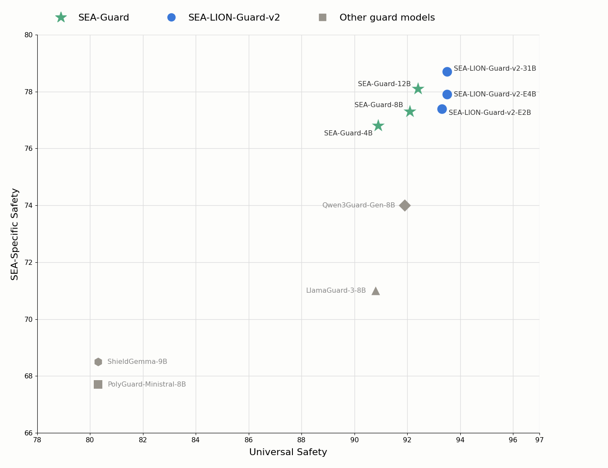
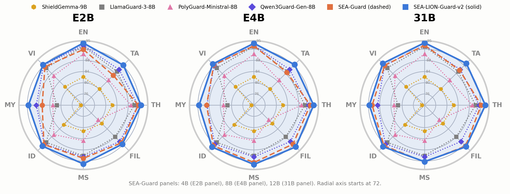

# Gemma-SEA-LION-Guard-v2-31B/E4B/E2B

**SEA-LION-Guard** is a collection of safety-focused Large Language Models (LLMs) designed specifically for the Southeast Asia (SEA) region. Alongside releasing the open model weights, we also offer a single API endpoint that exclusively serves this [decision-based](https://typesafe.ai/blog/introducing-system-one-models-and-jev) finetuned Gemma model. You can generate an API key to access this model at sea-lion api key manager.

## Model Details

SEA-LION stands for Southeast Asian Languages In One Network and is a collection of Large Language Models (LLMs) which have been pretrained and instruct-tuned for the Southeast Asia (SEA) region.

### Model Description

Unlike the SEA-Guard (renamed as SEA-LION-Guard v1) series, which is designed exclusively for **Content Moderation**, the SEA-LION-Guard-v2 series supports both **Content Moderation** and **Action Governance**.

Key enhancements in SEA-LION-Guard-v2 over SEA-Guard:

- **Multi-turn Conversation Evaluation**: Evaluates safety across multi-turn interactions.
- **Bring Your Own Policy (BYOP)**: Allows users to define and enforce their own sets of safety rules and policies.
- **Tool Interaction Evaluation**: Evaluates tool calls and tool responses to ensure safe and policy-compliant agent behavior.

For tokenization, the model employs the default tokenizer used in [Gemma-4-31B-IT](https://huggingface.co/google/gemma-4-31B-it) and [Gemma-4-E4B/E2B](https://huggingface.co/google/gemma-4-E4B-it).

- **Developed by:** AI Products Pillar, AI Singapore
- **Funded by:** National Research Foundation Singapore
- **Shared by:** AI Products Pillar, AI Singapore
- **Context length:** 256K tokens for 31B and 128K for E4B/E2B
- **Language(s):** Burmese, English, Indonesian, Filipino, Malay, Tamil, Thai, and Vietnamese
- **License:** [MIT](https://mit-license.org/)
- **Base model:** [Gemma-4-31B-IT](https://huggingface.co/google/gemma-4-31B-it) and [Gemma-4-E4B](https://huggingface.co/google/gemma-4-E4B-it)[/E2B](https://huggingface.co/google/gemma-4-E2B-it)

## Intended Uses and Limitations

This model is optimized to function as a decision model that produces structured probabilistic judgments rather than generating free-form text. it was fine-tuned to answer three core questions: `content_moderation`, which assigns individual probability scores (0.0–1.0) to the categories `safe`, `sensitive`, and `unsafe`; `rule_violation`, which estimates the probability (0.0–1.0) that the input violates the specified rules; and `rule_applicability`, which estimates the probability (0.0–1.0) that the specified rules apply to the input. However, users must be aware that the model is subject to the limitations common to generative AI, including the potential to hallucinate and produces ungrounded probability. Due to these inherent risks, human oversight is advised, and the model’s outputs should not be treated as absolute determinations without secondary verification.

## Uses

### How to Get Started with the Model

Install decision interface server

```
pip install decision-ui
```
Deploy the model using any inference engine, e.g., vLLM.

```
vllm serve aisingapore/Gemma-SEA-LION-Guard-v2-31B \
--host localhost \
--port 8000
```
Create decision inference server

```
decision-ui serve http://localhost:8000/v1 \
--port 9000
```
Compatible with SystemOne API and OpenAI's Decisions API

```
from typesafe_sdk import Choice, Noul, TypeSafeClient
with TypeSafeClient(base_url="http://localhost:9000/v1", api_key="EMPTY") as client:
    decision = client.system_one(
        model="aisingapore/Gemma-SEA-LION-Guard-v2-31B",
        state={"conversation":
            [
                {"role": "user", "content": "..."},
                {"role": "assistant", "content": "..."},
            ]
        },
        questions={
            "content_moderation": Choice(
                instructions="Is the latest conversation turn safe, sensitive, or unsafe?",
                criteria={"safe": None, "sensitive": None, "unsafe": None},
            ),
            "rule_applicability": Noul(
                instructions=(
                  "Is the latest conversation turn applicable to the following rule?\n"
                  "- <your_rule>"
                ),
            ),
            "rule_violation": Noul(
                instructions=(
                  "Does the latest conversation turn violate the following rule?\n"
                  "- <your_rule>"
                ),
            ),
        },
   )
print(decision.choices["content_moderation"].probabilities)
print(decision.nouls["rule_applicability"].noul)
print(decision.nouls["rule_violation"].noul)
```

```
from openai import OpenAI
client = OpenAI(base_url="http://localhost:9000/v1", api_key="EMPTY")
decision = client.decisions.create(
    model="aisingapore/Gemma-SEA-LION-Guard-v2-31B",
    input=[
        {"role": "user", "content": "..."},
        {"role": "assistant", "content": "..."},
    ],
    questions=[
        {
            "type": "choice",
            "name": "content_moderation",
            "instructions": "Is the latest conversation turn safe, sensitive, or unsafe?",
            "choices": [
                {"value": "safe"},
                {"value": "sensitive"},
                {"value": "unsafe"},
            ],
        },
        {
            "type": "predicate",
            "name": "rule_applicability",
            "instructions": (
                "Is the latest conversation turn applicable to the following rule?\n"
                "- <your_rule>"
            ),
        },
        {
            "type": "predicate",
            "name": "rule_violation",
            "instructions": (
                "Does the latest conversation turn violate the following rule?\n"
                "- <your_rule>"
            ),
        },
    ],
)
answers = {a.name: a for a in decision.answers}
print({p.value: p.probability for p in answers["content_moderation"].probabilities})
print(answers["rule_applicability"].probability)
print(answers["rule_violation"].probability)
```
## Evaluation

### Testing Data, Factors & Metrics

We use [SEA-SafeguardBench](https://aclanthology.org/2026.findings-acl.194/) to evaluate our SEA-LION-Guard-v2.

### Metrics

AUPRC is the primary metric to evaluate the safety classification of our models.

### Comparison Table

| Model | General Safety (EN + SEA) | SEA-Specific Safety (EN + SEA) | EN | TA | TH | FIL | MS | ID | MY | VI | Multi-turn | BYOP | Tool Eval |
| --- | --- | --- | --- | --- | --- | --- | --- | --- | --- | --- | --- | --- | --- |
| ShieldGemma-9B | 80.3 | 68.5 | 82.1 | 80.2 | 82.4 | 81.3 | 81.3 | 81.9 | 72.9 | 81.3 | ⛔ | ⛔ | ⛔ |
| LlamaGuard-3-8B | 90.8 | 71.0 | 93.0 | 89.0 | 90.2 | 88.0 | 90.1 | 90.8 | 81.5 | 90.8 | ✅ | ⛔ | ✅ |
| PolyGuard-Ministral-8B | 80.3 | 67.7 | 90.3 | 84.7 | 89.0 | 79.4 | 84.7 | 86.9 | 82.9 | 86.9 | ⛔ | ⛔ | ⛔ |
| Qwen3Guard-Gen-8B | 91.9 | 74.0 | 93.4 | 90.0 | 91.5 | 90.4 | 90.5 | 91.7 | 88.8 | 92.1 | ✅ | ⛔ | ⛔ |
| SEA-Guard-4B | 90.9 | 76.8 | 91.9 | 87.1 | 91.6 | 91.1 | 91.0 | 91.9 | 86.7 | 91.4 | ⛔ | ⛔ | ⛔ |
| SEA-Guard-8B | 92.1 | 77.3 | 93.2 | 88.6 | 92.1 | 91.7 | 92.5 | 92.5 | 88.9 | 92.3 | ⛔ | ⛔ | ⛔ |
| SEA-Guard-12B | 92.4 | 78.1 | 93.4 | 89.7 | 92.2 | 92.7 | 92.3 | 92.5 | 90.7 | 92.1 | ⛔ | ⛔ | ⛔ |
| **SEA-LION-Guard-v2-E2B** | 93.3 | 77.4 | 94.2 | 92.2 | 92.6 | 91.7 | 93.0 | 92.7 | 91.6 | 92.4 | ✅ | ✅ | ✅ |
| **SEA-LION-Guard-v2-E4B** | 93.5 | 77.9 | 94.1 | 92.5 | 93.3 | 93.1 | **93.2** | **93.2** | 91.6 | 92.8 | ✅ | ✅ | ✅ |
| **SEA-LION-Guard-v2-31B** | **93.5** | **78.7** | **94.3** | **93.1** | **93.7** | **93.0** | 92.2 | 93.0 | **91.7** | **93.1** | ✅ | ✅ | ✅ |

<figure style="text-align: center;">
  
  <figcaption>Universal Safety vs SEA-Specific Safety performance</figcaption>
</figure>

<figure style="text-align: center;">
  
  <figcaption>Comparative AUPRC performance across 8 SEA languages and safety categories</figcaption>
</figure>

## Uses

### Bias, Risks, and Limitations

It is important for users to be aware that our model exhibits certain limitations that warrant consideration. Although optimized to estimate probability scores for `content_moderation`, `rule_violation`, and `rule_applicability`, the model can still hallucinate or occasionally produce ungrounded score distributions. Users should exercise caution in interpreting and validating the model's outputs—particularly near decision thresholds—due to potential biases and underlying generative inconsistencies.

### Out-of-Scope Use

In no event shall the authors be held liable for any claims, damages, or other liabilities arising from the use of the released weights and codes.
