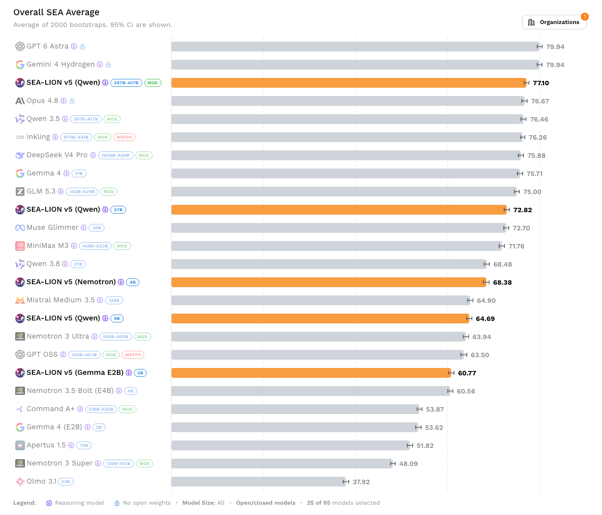

# Gemma-SEA-LION-v5

*Last update: 2026-11-18*

**Gemma-SEA-LION-v5-E2B** Gemma-SEA-LION-v5-E2B is based on [google/gemma-4-E2B-it](https://huggingface.co/google/gemma-4-E2B-it), the instruction-tuned version of Google DeepMind's [Gemma 4 E2B](https://huggingface.co/google/gemma-4-E2B). Gemma 4 E2B is a multimodal model with 2.3B effective parameters (5.1B with embeddings). It takes text, image and audio input, generates text output, and has a 128K-token context window.

From [google/gemma-4-E2B-it](https://huggingface.co/google/gemma-4-E2B-it), Gemma-SEA-LION-v5-E2B inherits:

- A built-in thinking mode that lets the model reason step by step before answering, enabled by default in this release
- Image understanding at variable aspect ratios and resolutions, including object detection, document and PDF parsing, screen and UI understanding, chart comprehension, multilingual OCR, handwriting recognition and pointing
- Video understanding from sequences of frames, with text and images freely interleaved in one prompt
- Audio input for speech recognition and speech-to-translated-text translation across multiple languages
- Native function calling for agentic workflows, plus code generation, completion and correction
- Native support for the system role, for more structured and controllable conversations
- Out-of-the-box support for 35+ languages, with pre-training on 140+ languages
- Efficient local execution on laptops and mobile devices  

**Nemotron-SEA-LION-v5-E4B** Nemotron-SEA-LION-v5-E4B is based on [nvidia/NVIDIA-Nemotron-3.5-Bolt-E4B-BF16](https://huggingface.co/nvidia/NVIDIA-Nemotron-3.5-Bolt-E4B-BF16), NVIDIA's post-trained version of Google DeepMind's [google/gemma-4-E4B-it](https://huggingface.co/google/gemma-4-E4B-it). Nemotron 3.5 Bolt E4B is a small language model with 8B parameters (4B effective). It takes text input, generates text output, and has a 64K-token context window.

From [nvidia/NVIDIA-Nemotron-3.5-Bolt-E4B-BF16](https://huggingface.co/nvidia/NVIDIA-Nemotron-3.5-Bolt-E4B-BF16), Nemotron-SEA-LION-v5-E4B inherits:

- Reasoning enabled by default, with a direct-answer mode and a runtime thinking budget
- Gemma's strong conversational abilities, plus a conversational mode for concise, spoken-style replies with less formatting
- Improved multi-turn tool use, instruction following and input grounding
- A focus on local voice and device assistants, interactive personas and embedded interfaces
- Low-memory, low time-to-first-token operation, so agents respond quickly while leaving headroom for applications or adjacent model pipelines


## Model Description

We post-trained [google/gemma-4-E2B-it](https://huggingface.co/google/gemma-4-E2B-it) and [nvidia/NVIDIA-Nemotron-3.5-Bolt-E4B-BF16](https://huggingface.co/nvidia/NVIDIA-Nemotron-3.5-Bolt-E4B-BF16) in English and SEA languages to create Gemma-SEA-LION-v5-E2B and Nemotron-SEA-LION-v5-E4B, respectively. The architecture, tokenizer, vision and audio encoders, sampling defaults and chat template are inherited from Gemma unchanged, except that thinking is enabled by default.


- Developed by: AI Products Pillar, AI Singapore
- Funded by: National Research Foundation Singapore
- Shared by: AI Products Pillar, AI Singapore
- Model type: Dense multimodal LLM
- Context length: 128K tokens for Gemma and 64k for Nemotron
- Language(s): Burmese, Chinese, English, Indonesian, Filipino, Malay, Tamil, Thai, and Vietnamese
- License: [MIT](https://mit-license.org/)
- Finetuned from model: [google/gemma-4-E2B-it](https://huggingface.co/google/gemma-4-E2B-it) and [nvidia/NVIDIA-Nemotron-3.5-Bolt-E4B-BF16](https://huggingface.co/nvidia/NVIDIA-Nemotron-3.5-Bolt-E4B-BF16)
- Repository: [SEA-LION v5 - an aisingapore Collection](https://huggingface.co/collections/aisingapore/sea-lion-v5)

## Getting Started

Use the code below to get started with the Gemma model using 🤗 Transformers, vLLM or SGLang.

<details>
<summary>Transformers</summary>

```bash
pip install -U transformers torch torchvision pillow accelerate
```

```py
from transformers import AutoProcessor, AutoModelForMultimodalLM
MODEL_ID = "aisingapore/Gemma-SEA-LION-v5-E2B"
# Load model
processor = AutoProcessor.from_pretrained(MODEL_ID)
model = AutoModelForMultimodalLM.from_pretrained(
    MODEL_ID,
    dtype="auto",
    device_map="auto"
)
# Prompt
messages = [
    {
        "role": "user",
        "content": "Saya mau kirim 40 kardus durian beku dari Medan ke Singapura lewat Pelabuhan Belawan. Jelaskan dokumen ekspor yang wajib saya siapkan, perkiraan waktu transit, dan risiko rantai dingin yang paling sering terjadi di rute ini. Jawab dalam Bahasa Indonesia, format poin.",
    },
]
# Process input
inputs = processor.apply_chat_template(
    messages,
    tokenize=True,
    return_dict=True,
    return_tensors="pt",
    add_generation_prompt=True,
    enable_thinking=False
).to(model.device)
input_len = inputs["input_ids"].shape[-1]
# Generate output
outputs = model.generate(**inputs, max_new_tokens=2048)
response = processor.decode(outputs[0][input_len:], skip_special_tokens=False)
# Parse output
processor.parse_response(response, prefix=inputs["input_ids"])
```

Thinking is enabled by default. The example above turns it off with `enable_thinking=False`; without that line, the model thinks before answering and `parse_response` separates the thinking from the answer.

</details>

<details>
<summary>vLLM</summary>

```bash
vllm serve aisingapore/Gemma-SEA-LION-v5-E2B \
  --reasoning-parser gemma4 \
  --enable-auto-tool-choice \
  --tool-call-parser gemma4
```

Then call the model:

```py
from openai import OpenAI
client = OpenAI(base_url="http://localhost:8000/v1", api_key="EMPTY")
response = client.chat.completions.create(
    model="aisingapore/Gemma-SEA-LION-v5-E2B",
    messages=[
        {
            "role": "user",
            "content": "Saya mau kirim 40 kardus durian beku dari Medan ke Singapura lewat Pelabuhan Belawan. Jelaskan dokumen ekspor yang wajib saya siapkan, perkiraan waktu transit, dan risiko rantai dingin yang paling sering terjadi di rute ini. Jawab dalam Bahasa Indonesia, format poin.",
        },
    ],
    extra_body={"chat_template_kwargs": {"enable_thinking": True}},
)
message = response.choices[0].message
print(message.reasoning)
print(message.content)
```

Tool calling:

```py
tools = [
    {
        "type": "function",
        "function": {
            "name": "get_weather",
            "description": "Get the current weather for a city",
            "parameters": {
                "type": "object",
                "properties": {"city": {"type": "string"}},
                "required": ["city"],
            },
        },
    }
]
response = client.chat.completions.create(
    model="aisingapore/Gemma-SEA-LION-v5-E2B",
    messages=[{"role": "user", "content": "Bagaimana cuaca di Jakarta hari ini?"}],
    tools=tools,
)
for call in response.choices[0].message.tool_calls or []:
    print(call.function.name, call.function.arguments)
```

</details>

<details>
<summary>SGLang</summary>

```bash
sglang serve --model-path aisingapore/Gemma-SEA-LION-v5-E2B \
  --reasoning-parser gemma4 \
  --tool-call-parser gemma4
```

Then call the model:

```py
from openai import OpenAI
client = OpenAI(base_url="http://localhost:30000/v1", api_key="EMPTY")
response = client.chat.completions.create(
    model="aisingapore/Gemma-SEA-LION-v5-E2B",
    messages=[
        {
            "role": "user",
            "content": "Saya mau kirim 40 kardus durian beku dari Medan ke Singapura lewat Pelabuhan Belawan. Jelaskan dokumen ekspor yang wajib saya siapkan, perkiraan waktu transit, dan risiko rantai dingin yang paling sering terjadi di rute ini. Jawab dalam Bahasa Indonesia, format poin.",
        },
    ],
    extra_body={"chat_template_kwargs": {"enable_thinking": True}},
)
message = response.choices[0].message
print(message.reasoning_content)
print(message.content)
```

For tool calling, pass `tools` as in the vLLM example above.

</details>

These examples are adapted from the [google/gemma-4-E2B-it](https://huggingface.co/google/gemma-4-E2B-it#getting-started) model card, which also covers audio, image and video input. For more vLLM options, see vLLM's [gemma-4-E2B-it recipe](https://recipes.vllm.ai/Google/gemma-4-E2B-it). For more SGLang options, see SGLang's [Gemma 4 cookbook](https://docs.sglang.io/cookbook/autoregressive/Google/Gemma4).

Use the code below to get started with the Nemotron model using 🤗 Transformers, vLLM or SGLang.

<details>
<summary>Transformers</summary>

```bash
pip install -U transformers torch torchvision pillow accelerate
```

```py
from transformers import AutoProcessor, AutoModelForMultimodalLM
MODEL_ID = "aisingapore/Nemotron-SEA-LION-v5-E4B"
# Load model
processor = AutoProcessor.from_pretrained(MODEL_ID)
model = AutoModelForMultimodalLM.from_pretrained(
    MODEL_ID,
    dtype="auto",
    device_map="auto"
)
# Prompt
messages = [
    {
        "role": "user",
        "content": "Saya mau kirim 40 kardus durian beku dari Medan ke Singapura lewat Pelabuhan Belawan. Jelaskan dokumen ekspor yang wajib saya siapkan, perkiraan waktu transit, dan risiko rantai dingin yang paling sering terjadi di rute ini. Jawab dalam Bahasa Indonesia, format poin.",
    },
]
# Process input
inputs = processor.apply_chat_template(
    messages,
    tokenize=True,
    return_dict=True,
    return_tensors="pt",
    add_generation_prompt=True,
    enable_thinking=False
).to(model.device)
input_len = inputs["input_ids"].shape[-1]
# Generate output
outputs = model.generate(**inputs, max_new_tokens=2048)
response = processor.decode(outputs[0][input_len:], skip_special_tokens=False)
# Parse output
processor.parse_response(response, prefix=inputs["input_ids"])
```

Thinking is enabled by default. The example above turns it off with `enable_thinking=False`; without that line, the model thinks before answering and `parse_response` separates the thinking from the answer.

</details>

<details>
<summary>vLLM</summary>

```bash
vllm serve aisingapore/Nemotron-SEA-LION-v5-E4B \
  --reasoning-parser gemma4 \
  --enable-auto-tool-choice \
  --tool-call-parser gemma4 \
  --limit-mm-per-prompt '{"image":0,"video":0,"audio":0}'
```

Then call the model:

```py
from openai import OpenAI
client = OpenAI(base_url="http://localhost:8000/v1", api_key="EMPTY")
response = client.chat.completions.create(
    model="aisingapore/Nemotron-SEA-LION-v5-E4B",
    messages=[
        {
            "role": "user",
            "content": "Saya mau kirim 40 kardus durian beku dari Medan ke Singapura lewat Pelabuhan Belawan. Jelaskan dokumen ekspor yang wajib saya siapkan, perkiraan waktu transit, dan risiko rantai dingin yang paling sering terjadi di rute ini. Jawab dalam Bahasa Indonesia, format poin.",
        },
    ],
    extra_body={"skip_special_tokens": False, "chat_template_kwargs": {"enable_thinking": True}},
)
message = response.choices[0].message
print(message.reasoning)
print(message.content)
```

For brief, spoken-style replies, add `"conversational_mode": True` to `chat_template_kwargs`.

Tool calling:

```py
tools = [
    {
        "type": "function",
        "function": {
            "name": "get_weather",
            "description": "Get the current weather for a city",
            "parameters": {
                "type": "object",
                "properties": {"city": {"type": "string"}},
                "required": ["city"],
            },
        },
    }
]
response = client.chat.completions.create(
    model="aisingapore/Nemotron-SEA-LION-v5-E4B",
    messages=[{"role": "user", "content": "Bagaimana cuaca di Jakarta hari ini?"}],
    tools=tools,
    extra_body={"skip_special_tokens": False, "chat_template_kwargs": {"enable_thinking": True}},
)
for call in response.choices[0].message.tool_calls or []:
    print(call.function.name, call.function.arguments)
```

</details>

<details>
<summary>SGLang</summary>

```bash
sglang serve --model-path aisingapore/Nemotron-SEA-LION-v5-E4B \
  --reasoning-parser gemma4 \
  --tool-call-parser gemma4
```

Then call the model:

```py
from openai import OpenAI
client = OpenAI(base_url="http://localhost:30000/v1", api_key="EMPTY")
response = client.chat.completions.create(
    model="aisingapore/Nemotron-SEA-LION-v5-E4B",
    messages=[
        {
            "role": "user",
            "content": "Saya mau kirim 40 kardus durian beku dari Medan ke Singapura lewat Pelabuhan Belawan. Jelaskan dokumen ekspor yang wajib saya siapkan, perkiraan waktu transit, dan risiko rantai dingin yang paling sering terjadi di rute ini. Jawab dalam Bahasa Indonesia, format poin.",
        },
    ],
    extra_body={"chat_template_kwargs": {"enable_thinking": True}},
)
message = response.choices[0].message
print(message.reasoning_content)
print(message.content)
```

For tool calling, pass `tools` as in the vLLM example above.

</details>

These examples are adapted from the [nvidia/NVIDIA-Nemotron-3.5-Bolt-E4B-BF16](https://huggingface.co/nvidia/NVIDIA-Nemotron-3.5-Bolt-E4B-BF16#quick-start-guide) and [google/gemma-4-E4B-it](https://huggingface.co/google/gemma-4-E4B-it#getting-started) model cards; the Nemotron card also covers conversational mode, the runtime thinking budget and more vLLM options. For more SGLang options, see SGLang's [Gemma 4 cookbook](https://docs.sglang.io/cookbook/autoregressive/Google/Gemma4).


## Training

Training was text-only, using prompts from [aisingapore/SEA-Instruct-2602](https://huggingface.co/datasets/aisingapore/SEA-Instruct-2602), an instruction dataset in English and Southeast Asian languages. We trained with Reinforcement Learning and On-Policy Distillation simultaneously, with [google/gemma-4-31B-it](https://huggingface.co/google/gemma-4-31B-it) as the teacher and an LLM judge ([DeepSeek-V4.1-Flash-1017](https://huggingface.co/deepseek-ai/DeepSeek-V4.1-Flash-1017)) grading answers against per-prompt rubrics.

## Evaluation

We evaluated SEA-LION-v5 on multilingual, multicultural, multi-turn chat and instruction-following capabilities. For the evaluation used in SEA-LION-v5, the new version of SEA-HELM (Southeast Asian Holistic Evaluation of Language Models) is adopted as the evaluation framework.

### Testing Data

**General language capabilities**: For the evaluation of general language capabilities, we employed the SEA-HELM evaluation benchmark across a variety of tasks. These tasks include Question Answering (QA), Sentiment Analysis (Sentiment), Metaphor Understanding, Toxicity Detection (Toxicity), SEA-SafeguardBench, Translation in both directions (Eng>Lang & Lang>Eng), Abstractive Summarisation (Abssum), Causal Reasoning (Causal), Natural Language Inference (NLI), Linguistic Diagnostics (LINDSEA), KOPI-SEA, Cultural Knowledge (Kalahi), Thai Exam, and Global MMLU Lite. Language coverage within SEA-HELM includes Filipino, Indonesian, Tamil, Thai, and Vietnamese, and is now further extended to Malay and Burmese.

**Instruction-following and Multi-turn Chat**: We evaluated instruction following with SEA-IFEval (based on IFEval) and multi-turn chat with SEA-MTBench (based on MT-Bench). Both datasets were originally in English. Linguists and native speakers in the team filtered, localised and translated them into each target language so that the examples remain reasonable, meaningful and natural, avoiding the translationese and cultural erasure of machine-translated benchmarks. Native speakers of the target languages took part in every stage of dataset planning and construction.

### Factors

All evaluations ran with the model-specific generation parameters defined in the model config. Each evaluation consisted of 8 runs with different seeds, and the average score for each prompt was then calculated.

Bootstrapping with replacement for each prompt was done to obtain the task score. The final result is then the aggregation of the various task scores.

For tasks that are not judged by an LLM, the model was expected to provide an answer tag from which the answer was automatically extracted. Additionally, when options were provided, the answer should comprise one of the pre-defined options. For tasks that are judged using an LLM, the entire generated text was given to the LLM for judging.

The evaluation was done zero-shot with native prompts on a sample of 100-1000 instances for each dataset. Task prompts are issued in the target language itself, on the view that full support for a language requires a model both to interpret native instructions and to respond coherently in that language.

- **SEA-IFEval**: SEA-IFEval evaluates a model's ability to adhere to constraints provided in the prompt, for example, beginning a response with a specific word/phrase or answering with a certain number of sections. Additionally, accuracy is normalised by the proportion of responses in the correct language (if the model performs the task correctly but responds in the wrong language, it is judged to have failed the task).
- **SEA-MTBench**: SEA-MTBench evaluates a model's ability to engage in multi-turn (2 turns) conversations and respond in ways that align with human needs. We use [gpt-oss-120b](https://huggingface.co/openai/gpt-oss-120b) as the judge model. The metric used is the average criteria score where model responses were judged based on a set of specific criteria for each prompt.
- **KOPI-SEA**: KOPI-SEA evaluates a model’s ability to generate a cultural concept based on a set of related words. We use [gpt-oss-120b](https://huggingface.co/openai/gpt-oss-120b) as the judge model to determine if the model identifies the correct concept. The metric used is the average criteria score.
- **LINDSEA 2.0**: LINDSEA 2.0 evaluates a model’s ability to generate a text that contains a particular syntactic phenomenon. We use [gpt-oss-120b](https://huggingface.co/openai/gpt-oss-120b) to judge if the syntactic phenomenon can be found in the text and follows the prescribed grammar rules. The metric used is the average criteria score.

### Metrics

The following metrics were used for text capabilities:

| Task | Metric |
| --- | --- |
| Sentiment Analysis | Accuracy |
| Extractive QA (ID, VI, TH, TA) | ChrF++ |
| MCQ-QA (TL, MY, MS) | Accuracy |
| Metaphor | Accuracy |
| Abstractive Summarisation | Rouge-L |
| Translations | MetricX-24 score (with reference) |
| Toxicity Detection | Accuracy |
| SEA-Safeguard | Accuracy |
| Causal Reasoning | Accuracy |
| Natural Language Inference | Accuracy |
| LINDSEA | Accuracy |
| LINDSEA 2.0 | Average criteria score |
| Global MMLU Lite | Accuracy |
| ThaiExam | Accuracy |
| Kalahi | Accuracy |
| Kalahi (LLM-as-a-Judge) | Average criteria score |
| KOPI-SEA | Average criteria score |
| SEA-IFEval | Accuracy |
| SEA-MTBench (LLM-as-a-Judge) | Average criteria score |

### Results


*Overall SEA-HELM average, with the SEA-LION v5 models in orange. Leaderboard captured on 17 November 2026.*

For more details and a breakdown by task and language, see the [SEA-LION Leaderboard](https://leaderboard.sea-lion.ai/).

#### Performance

| GPU Chip | Model | Model Size (GB) | VRAM Required (GB) | Time to First Token (s) | Tokens per Second |
| --- | --- | --- | --- | --- | --- |
| H200 | Gemma | 10.3 | 9.9 | 0.07 | 192 |
| H200 | Nemotraon | 16.0 | 14.2 | 0.09 | 147 |

> *Additional Remarks:*
>
> - *TTFT and Tokens per Second: measured with vLLM on localhost and concurrency = 1.*
> - *Offload all layers to GPU, Context Length 8192*
> - *Reported results are the median (p50) values, calculated across 10 requests.*
> - *Input size 4K, output 1K*
>

## Out-of-Scope Use

The model has not been aligned for safety. Developers and users should perform their own safety fine-tuning and related security measures. In no event shall the authors be held liable for any claims, damages, or other liabilities arising from the use of the released weights and codes.

## Bias, Risks, and Limitations

The model was not tested for robustness against adversarial prompting. It is important for users to be aware that our model exhibits certain limitations that warrant consideration. Like many LLMs, the model can hallucinate and occasionally generates irrelevant content, introducing fictional elements that are not grounded in the provided context. Users should also exercise caution in interpreting and validating the model's responses due to the potential inconsistencies.

For training data, safety evaluation and limitations, see the [google/gemma-4-E2B-it](https://huggingface.co/google/gemma-4-E2B-it) and [nvidia/NVIDIA-Nemotron-3.5-Bolt-E4B-BF16](https://huggingface.co/nvidia/NVIDIA-Nemotron-3.5-Bolt-E4B-BF16) model card.

Gemma-SEA-LION-v5-E2B is built on [google/gemma-4-E2B-it](https://huggingface.co/google/gemma-4-E2B-it), part of Google DeepMind's Gemma 4 family ([technical report](https://arxiv.org/abs/2607.02770)).

Nemotron-SEA-LION-v5-E4B is built on [nvidia/NVIDIA-Nemotron-3.5-Bolt-E4B-BF16](https://huggingface.co/nvidia/NVIDIA-Nemotron-3.5-Bolt-E4B-BF16), part of NVIDIA's Nemotron 3.5 family ([technical report](https://research.nvidia.com/labs/nemotron/files/NVIDIA-Nemotron-3.5-Bolt-E4B-4GB-Technical-Report.pdf)), which NVIDIA post-trained from Google DeepMind's [google/gemma-4-E4B-it](https://huggingface.co/google/gemma-4-E4B-it).

