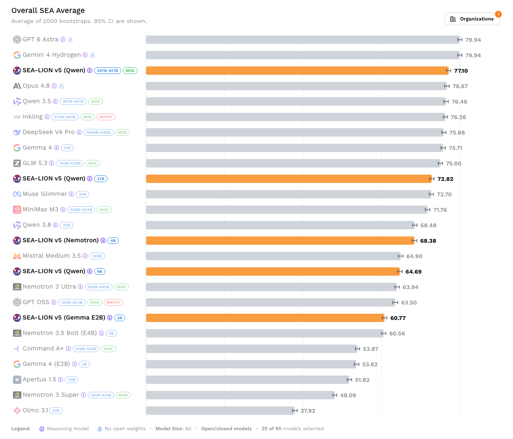
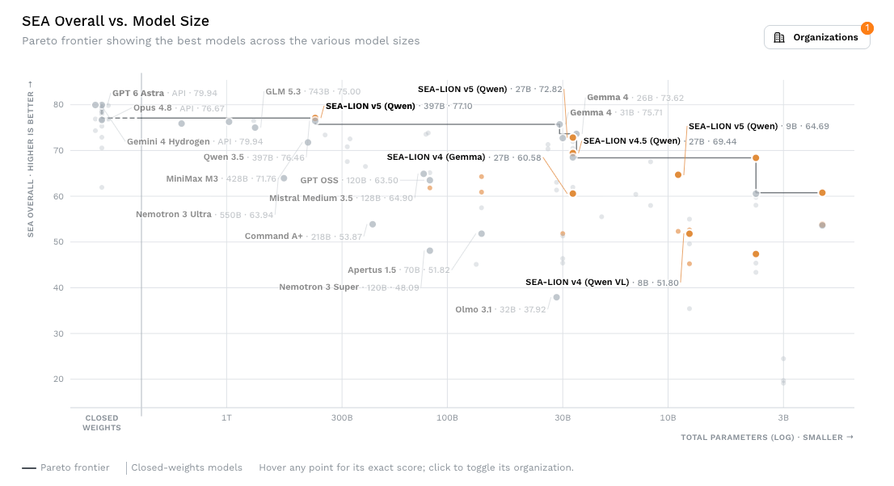
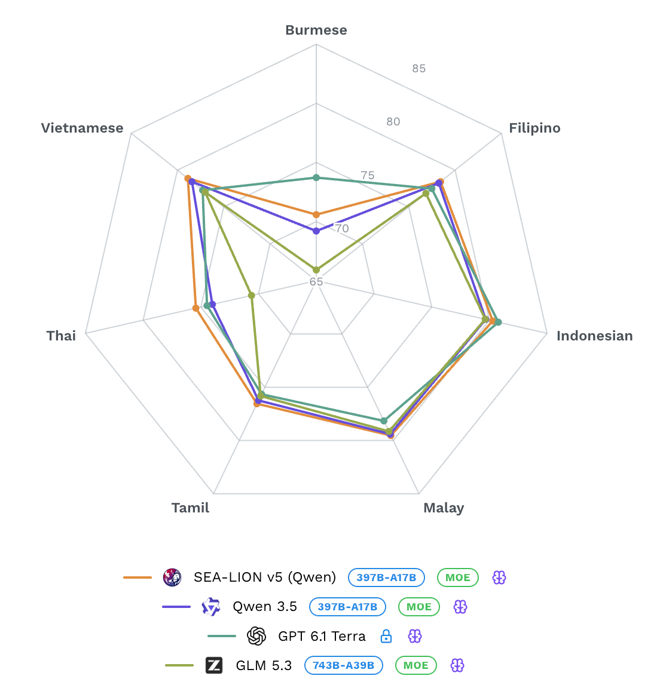
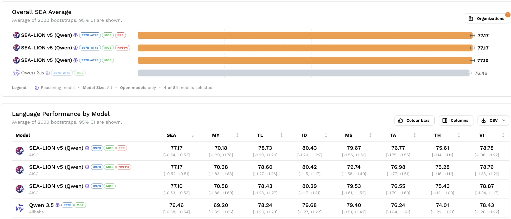

# Qwen-SEA-LION-v5

*Last update: 2026-11-18*

**Qwen-SEA-LION-v5-397B-A17B-Plus**
Qwen-SEA-LION-v5-397B-A17B-Plus is based on [Qwen/Qwen3.5-397B-A17B](https://huggingface.co/Qwen/Qwen3.5-397B-A17B), converted to Qwen4Exp, the architecture of [Qwen/Qwen3.8-Flash-Next](https://huggingface.co/Qwen/Qwen3.8-Flash-Next). It is a multimodal Mixture-of-Experts model with about 398B effective parameters (569B with its n-gram tables), about 19B of them activated per token. It takes text, image and video input, generates text output, and has a 262,144-token context window.

From [Qwen/Qwen3.5-397B-A17B](https://huggingface.co/Qwen/Qwen3.5-397B-A17B), Qwen-SEA-LION-v5-397B-A17B-Plus inherits:

- Thinking mode by default: the model reasons step by step before giving its final response
- A unified vision-language foundation: early-fusion training on multimodal tokens achieves parity with Qwen3 and outperforms Qwen3-VL across reasoning, coding, agent and visual-understanding benchmarks
- An efficient hybrid architecture of Gated DeltaNet and sparse Mixture-of-Experts, for high-throughput inference with minimal latency and cost
- Reinforcement learning scaled across million-agent environments, for robust real-world adaptability
- Strong tool calling for agentic use, including with Qwen-Agent and Qwen Code
- Native multi-token prediction (MTP) for faster inference with speculative decoding
- Coverage of 201 languages and dialects, with nuanced cultural and regional understanding
- A native context of 262,144 tokens, extensible to about 1M tokens with YaRN

**Qwen-SEA-LION-v5-27B**
Qwen-SEA-LION-v5-27B is based on [Qwen/Qwen3.8-27B](https://huggingface.co/Qwen/Qwen3.8-27B), the Qwen team's post-trained 27B model in the Qwen3.8 family. Qwen3.8-27B is a multimodal model with 27B parameters. It takes text, image and video input, generates text output, and has a 262,144-token context window.

From [Qwen/Qwen3.8-27B](https://huggingface.co/Qwen/Qwen3.8-27B), Qwen-SEA-LION-v5-27B inherits:

- Thinking mode by default, with per-request control: turn it off, tune reasoning depth with `reasoning_effort`, and keep earlier reasoning in context with `preserve_thinking` (also on by default)
- Comprehensive improvements across coding, professional work, research and long-horizon agentic tasks
- Stronger autonomous planning and better handling of environment feedback, for more reliable end-to-end task completion
- Broader support for popular harnesses and development tools, for easier integration into existing stacks
- Native image and video understanding, from STEM diagrams and documents to hour-scale videos
- Native multi-token prediction (MTP) for faster inference with speculative decoding
- A native context of 262,144 tokens, extensible to about 1M tokens with YaRN

 **Qwen-SEA-LION-v5-9B**
 Qwen-SEA-LION-v5-9B is based on [Qwen/Qwen3.5-9B](https://huggingface.co/Qwen/Qwen3.5-9B), the post-trained version of the Qwen team's [Qwen3.5-9B-Base](https://huggingface.co/Qwen/Qwen3.5-9B-Base). Qwen3.5-9B is a multimodal model with 9B parameters. It takes text, image and video input, generates text output, and has a 262,144-token context window.

From [Qwen/Qwen3.5-9B](https://huggingface.co/Qwen/Qwen3.5-9B), Qwen-SEA-LION-v5-9B inherits:

- Thinking mode by default: the model reasons step by step before giving its final response
- A unified vision-language foundation: early-fusion training on multimodal tokens achieves parity with Qwen3 and outperforms Qwen3-VL across reasoning, coding, agent and visual-understanding benchmarks
- An efficient hybrid architecture of Gated DeltaNet and gated attention, for high-throughput inference with minimal latency and cost
- Reinforcement learning scaled across million-agent environments, for robust real-world adaptability
- Strong tool calling for agentic use, including with Qwen-Agent and Qwen Code
- Native multi-token prediction (MTP) for faster inference with speculative decoding
- Coverage of 201 languages and dialects, with nuanced cultural and regional understanding
- A native context of 262,144 tokens, extensible to about 1M tokens with YaRN


## Model Description

We converted [Qwen/Qwen3.5-397B-A17B](https://huggingface.co/Qwen/Qwen3.5-397B-A17B) to Qwen4Exp and post-trained it in English and SEA languages to create Qwen-SEA-LION-v5-397B-A17B-Plus. The tokenizer, vision encoder and sampling defaults are inherited from Qwen unchanged. The chat template is [Qwen/Qwen3.8-27B](https://huggingface.co/Qwen/Qwen3.8-27B)'s without reasoning effort, so thinking and preserved thinking are enabled by default. Set `preserve_thinking=False` to keep only the reasoning since the latest user message, as in Qwen3.5.

We post-trained [Qwen/Qwen3.8-27B](https://huggingface.co/Qwen/Qwen3.8-27B) in English and SEA languages to create Qwen-SEA-LION-v5-27B. The architecture, tokenizer, vision encoder, sampling defaults and chat template are inherited from Qwen unchanged; as in Qwen3.8, thinking and preserved thinking are enabled by default.

We also post-trained [Qwen/Qwen3.5-9B](https://huggingface.co/Qwen/Qwen3.5-9B) in English and SEA languages to create Qwen-SEA-LION-v5-9B. The architecture, tokenizer, vision encoder and multi-token prediction head are inherited from Qwen unchanged. The chat template is [Qwen/Qwen3.8-27B](https://huggingface.co/Qwen/Qwen3.8-27B)'s without reasoning effort, so thinking and preserved thinking are enabled by default. Set `preserve_thinking=False` to keep only the reasoning since the latest user message, as in Qwen3.5.


- Developed by: AI Products Pillar, AI Singapore
- Funded by: National Research Foundation Singapore
- Shared by: AI Products Pillar, AI Singapore
- Model type: Causal language model with vision encoder
- Context length: 262,144 tokens
- Language(s): Burmese, Chinese, English, Indonesian, Filipino, Malay, Tamil, Thai, and Vietnamese
- License: [MIT](https://mit-license.org/)
- Finetuned from model: [Qwen/Qwen3.5-397B-A17B](https://huggingface.co/Qwen/Qwen3.5-397B-A17B),  [Qwen/Qwen3.8-27B](https://huggingface.co/Qwen/Qwen3.8-27B) and  [Qwen/Qwen3.5-9B](https://huggingface.co/Qwen/Qwen3.5-9B) 
- Repository: [SEA-LION v5 - an aisingapore Collection](https://huggingface.co/collections/aisingapore/sea-lion-v5)

### Architecture Conversion on 397B-A17B-Plus

We have specifically converted [Qwen3.5-397B-A17B](https://huggingface.co/Qwen/Qwen3.5-397B-A17B) to Qwen4Exp, the architecture of [Qwen3.8-Flash-Next](https://huggingface.co/Qwen/Qwen3.8-Flash-Next), using its three components with settings adapted where needed:

- **QSA hybrid attention:** Qwen4Exp pairs Gated DeltaNet with Qwen Sparse Attention (QSA). In each QSA layer, a small indexer scores compressed four-token blocks of the context, and each query attends to up to 2,048 tokens from the highest-scoring complete blocks, plus the incomplete trailing block. This reduces the work of full attention on long contexts. We kept Qwen3.5-397B's 45 Gated DeltaNet layers and converted its 15 full-attention layers to QSA with Qwen4Exp's indexer settings.
- **Gated Residual:** Qwen4Exp widens the residual stream into four parallel branches. Each attention and feed-forward block reads an input-dependent blend of them and writes back with one weight per branch, so layers can route information more flexibly. We used the same four branches, with the bottleneck scaled to our wider model.
- **N-gram Embedding:** Qwen4Exp adds a hashed bigram and trigram memory at layer 2, with sparse lookups that can sit in host memory. We seeded our tables from Qwen3.8-Flash-Next's trained ones, widened each head from 160 to 256 channels for our 4,096-wide backbone, and doubled the buckets to about 40M per head, for about 164B parameters in the n-gram tables.

We also added QSA and Gated Residual to the MTP draft layer, and kept Qwen3.5-397B's SiLU output gating in Gated DeltaNet (Flash-Next uses sigmoid).


## Getting Started for Qwen series

Use the code below to get started with the model using 🤗 Transformers, vLLM or SGLang.

<details>
<summary>Transformers</summary>

```bash
pip install -U transformers torch torchvision pillow accelerate
```

```py
from transformers import AutoProcessor, AutoModelForImageTextToText
MODEL_ID = "aisingapore/Qwen-SEA-LION-v5-397B-A17B-Plus"
# Load model
processor = AutoProcessor.from_pretrained(MODEL_ID)
model = AutoModelForImageTextToText.from_pretrained(
    MODEL_ID,
    dtype="auto",
    device_map="auto"
)
# Prompt
messages = [
    {
        "role": "user",
        "content": "Saya mau kirim 40 kardus durian beku dari Medan ke Singapura lewat Pelabuhan Belawan. Jelaskan dokumen ekspor yang wajib saya siapkan, perkiraan waktu transit, dan risiko rantai dingin yang paling sering terjadi di rute ini. Jawab dalam Bahasa Indonesia, format poin.",
    },
]
# Process input
inputs = processor.apply_chat_template(
    messages,
    tokenize=True,
    return_dict=True,
    return_tensors="pt",
    add_generation_prompt=True,
    enable_thinking=False
).to(model.device)
input_len = inputs["input_ids"].shape[-1]
# Generate output
outputs = model.generate(**inputs, max_new_tokens=2048)
response = processor.decode(outputs[0][input_len:], skip_special_tokens=False)
# Parse output
processor.parse_response(response, prefix=inputs["input_ids"])
```

Thinking is enabled by default. The example above turns it off with `enable_thinking=False`; without that line, the model thinks before answering and `parse_response` separates the thinking from the answer. The thinking often runs to several thousand tokens, so raise `max_new_tokens` when it is on (Qwen recommends 32,768 for most queries).

</details>

<details>
<summary>vLLM</summary>

```bash
vllm serve aisingapore/Qwen-SEA-LION-v5-397B-A17B-Plus \
  --tensor-parallel-size 8 \
  --enable-expert-parallel \
  --engram-config '{"cpu_offload":true}' \
  --model-loader-extra-config '{"enable_weights_track":false}' \
  --reasoning-parser qwen3 \
  --enable-auto-tool-choice \
  --tool-call-parser qwen3_coder
```

`--engram-config '{"cpu_offload":true}'` keeps the n-gram tables (about 164B parameters, 328 GB in BF16) in host memory and fetches the rows each step needs. vLLM turns it on by default. vLLM 0.34 pads one Gated Residual projection to a multiple of 16 rows and then reports the padding as a missing weight; `--model-loader-extra-config '{"enable_weights_track":false}'` skips that check.

Then call the model:

```py
from openai import OpenAI
client = OpenAI(base_url="http://localhost:8000/v1", api_key="EMPTY")
response = client.chat.completions.create(
    model="aisingapore/Qwen-SEA-LION-v5-397B-A17B-Plus",
    messages=[
        {
            "role": "user",
            "content": "Saya mau kirim 40 kardus durian beku dari Medan ke Singapura lewat Pelabuhan Belawan. Jelaskan dokumen ekspor yang wajib saya siapkan, perkiraan waktu transit, dan risiko rantai dingin yang paling sering terjadi di rute ini. Jawab dalam Bahasa Indonesia, format poin.",
        },
    ],
    extra_body={"chat_template_kwargs": {"enable_thinking": True}},
)
message = response.choices[0].message
print(message.reasoning)
print(message.content)
```

Tool calling:

```py
tools = [
    {
        "type": "function",
        "function": {
            "name": "get_weather",
            "description": "Get the current weather for a city",
            "parameters": {
                "type": "object",
                "properties": {"city": {"type": "string"}},
                "required": ["city"],
            },
        },
    }
]
response = client.chat.completions.create(
    model="aisingapore/Qwen-SEA-LION-v5-397B-A17B-Plus",
    messages=[{"role": "user", "content": "Bagaimana cuaca di Jakarta hari ini?"}],
    tools=tools,
)
for call in response.choices[0].message.tool_calls or []:
    print(call.function.name, call.function.arguments)
```

</details>

<details>
<summary>SGLang</summary>

```bash
sglang serve --model-path aisingapore/Qwen-SEA-LION-v5-397B-A17B-Plus \
  --tp 8 \
  --ple-offload-embedding \
  --reasoning-parser qwen3 \
  --tool-call-parser qwen3_coder
```

`--ple-offload-embedding` keeps the n-gram tables (about 164B parameters, 328 GB in BF16) in pinned host memory. SGLang turns it on by default.

Then call the model:

```py
from openai import OpenAI
client = OpenAI(base_url="http://localhost:30000/v1", api_key="EMPTY")
response = client.chat.completions.create(
    model="aisingapore/Qwen-SEA-LION-v5-397B-A17B-Plus",
    messages=[
        {
            "role": "user",
            "content": "Saya mau kirim 40 kardus durian beku dari Medan ke Singapura lewat Pelabuhan Belawan. Jelaskan dokumen ekspor yang wajib saya siapkan, perkiraan waktu transit, dan risiko rantai dingin yang paling sering terjadi di rute ini. Jawab dalam Bahasa Indonesia, format poin.",
        },
    ],
    extra_body={"chat_template_kwargs": {"enable_thinking": True}},
)
message = response.choices[0].message
print(message.reasoning_content)
print(message.content)
```

For tool calling, pass `tools` as in the vLLM example above.

</details>

These examples are adapted from the [Qwen/Qwen3.5-397B-A17B](https://huggingface.co/Qwen/Qwen3.5-397B-A17B#quickstart) model card, which also covers image and video input, multi-token prediction and recommended sampling settings. For hardware, N-gram Embedding offload and more vLLM options, see vLLM's [Qwen3.8-Flash-Next recipe](https://recipes.vllm.ai/Qwen/Qwen3.8-Flash-Next). For more SGLang options, see SGLang's [Qwen3.8-Flash-Next cookbook](https://docs.sglang.io/cookbook/autoregressive/Qwen/Qwen3.8-Flash-Next).

## Training

Training was text-only, using prompts from [aisingapore/SEA-Instruct-2602](https://huggingface.co/datasets/aisingapore/SEA-Instruct-2602), an instruction dataset in English and Southeast Asian languages. We trained with Reinforcement Learning and On-Policy Distillation simultaneously, with [Qwen/Qwen3.8-2.4T-A95B](https://huggingface.co/Qwen/Qwen3.8-2.4T-A95B) as the teacher and an LLM judge ([DeepSeek-V4.1-Flash-1017](https://huggingface.co/deepseek-ai/DeepSeek-V4.1-Flash-1017)) grading answers against per-prompt rubrics.

*397-A17B-Plus training is experimental and still in progress.*

## Evaluation

We evaluated SEA-LION-v5 on multilingual, multicultural, multi-turn chat and instruction-following capabilities. For the evaluation used in SEA-LION-v5, the new version of SEA-HELM (Southeast Asian Holistic Evaluation of Language Models) is adopted as the evaluation framework.

### Testing Data

**General language capabilities**: For the evaluation of general language capabilities, we employed the SEA-HELM evaluation benchmark across a variety of tasks. These tasks include Question Answering (QA), Sentiment Analysis (Sentiment), Metaphor Understanding, Toxicity Detection (Toxicity), SEA-SafeguardBench, Translation in both directions (Eng>Lang & Lang>Eng), Abstractive Summarisation (Abssum), Causal Reasoning (Causal), Natural Language Inference (NLI), Linguistic Diagnostics (LINDSEA), KOPI-SEA, Cultural Knowledge (Kalahi), Thai Exam, and Global MMLU Lite. Language coverage within SEA-HELM includes Filipino, Indonesian, Tamil, Thai, and Vietnamese, and is now further extended to Malay and Burmese.

**Instruction-following and Multi-turn Chat**: We evaluated instruction following with SEA-IFEval (based on IFEval) and multi-turn chat with SEA-MTBench (based on MT-Bench). Both datasets were originally in English. Linguists and native speakers in the team filtered, localised and translated them into each target language so that the examples remain reasonable, meaningful and natural, avoiding the translationese and cultural erasure of machine-translated benchmarks. Native speakers of the target languages took part in every stage of dataset planning and construction.

### Factors

All evaluations ran with the model-specific generation parameters defined in the model config. Each evaluation consisted of 8 runs with different seeds, and the average score for each prompt was then calculated.

Bootstrapping with replacement for each prompt was done to obtain the task score. The final result is then the aggregation of the various task scores.

For tasks that are not judged by an LLM, the model was expected to provide an answer tag from which the answer was automatically extracted. Additionally, when options were provided, the answer should comprise one of the pre-defined options. For tasks that are judged using an LLM, the entire generated text was given to the LLM for judging.

The evaluation was done zero-shot with native prompts on a sample of 100-1000 instances for each dataset. Task prompts are issued in the target language itself, on the view that full support for a language requires a model both to interpret native instructions and to respond coherently in that language.

- **SEA-IFEval**: SEA-IFEval evaluates a model's ability to adhere to constraints provided in the prompt, for example, beginning a response with a specific word/phrase or answering with a certain number of sections. Additionally, accuracy is normalised by the proportion of responses in the correct language (if the model performs the task correctly but responds in the wrong language, it is judged to have failed the task).
- **SEA-MTBench**: SEA-MTBench evaluates a model's ability to engage in multi-turn (2 turns) conversations and respond in ways that align with human needs. We use [gpt-oss-120b](https://huggingface.co/openai/gpt-oss-120b) as the judge model. The metric used is the average criteria score where model responses were judged based on a set of specific criteria for each prompt.
- **KOPI-SEA**: KOPI-SEA evaluates a model’s ability to generate a cultural concept based on a set of related words. We use [gpt-oss-120b](https://huggingface.co/openai/gpt-oss-120b) as the judge model to determine if the model identifies the correct concept. The metric used is the average criteria score.
- **LINDSEA 2.0**: LINDSEA 2.0 evaluates a model’s ability to generate a text that contains a particular syntactic phenomenon. We use [gpt-oss-120b](https://huggingface.co/openai/gpt-oss-120b) to judge if the syntactic phenomenon can be found in the text and follows the prescribed grammar rules. The metric used is the average criteria score.

### Metrics

The following metrics were used for text capabilities:

| Task | Metric |
| --- | --- |
| Sentiment Analysis | Accuracy |
| Extractive QA (ID, VI, TH, TA) | ChrF++ |
| MCQ-QA (TL, MY, MS) | Accuracy |
| Metaphor | Accuracy |
| Abstractive Summarisation | Rouge-L |
| Translations | MetricX-24 score (with reference) |
| Toxicity Detection | Accuracy |
| SEA-Safeguard | Accuracy |
| Causal Reasoning | Accuracy |
| Natural Language Inference | Accuracy |
| LINDSEA | Accuracy |
| LINDSEA 2.0 | Average criteria score |
| Global MMLU Lite | Accuracy |
| ThaiExam | Accuracy |
| Kalahi | Accuracy |
| Kalahi (LLM-as-a-Judge) | Average criteria score |
| KOPI-SEA | Average criteria score |
| SEA-IFEval | Accuracy |
| SEA-MTBench (LLM-as-a-Judge) | Average criteria score |

### Results


**Figure 1.** *Overall SEA-HELM average, with the SEA-LION v5 models in orange. Leaderboard captured on 17 November 2026.*


**Figure 2.** *Qwen-SEA-LION-v5-397B-A17B-Plus leads the Pareto frontier across open models of similar or larger sizes.*


**Figure 3.** *SEA-HELM score per language: Comparing Qwen-SEA-LION-v5-397B-A17B-Plus (in orange) against Qwen 3.5 397B and other open and commercial models of similar or larger sizes.*


**Figure 4.** *Full-precision, quantized FP8 and NVFP4 performance across SEA-HELM tasks. Quantization introduces little to no accuracy degradation, allowing developers to deploy high-efficiency 4-bit and 8-bit weights without sacrificing regional reasoning quality.*

For more details and a breakdown by task and language, see the [SEA-LION Leaderboard](https://leaderboard.sea-lion.ai/).


Qwen-SEA-LION-v5-397B-A17B-Plus is built on [Qwen/Qwen3.5-397B-A17B](https://huggingface.co/Qwen/Qwen3.5-397B-A17B), part of the Qwen team's Qwen3.5 family ([blog](https://qwen.ai/blog?id=qwen3.5)), and uses the Qwen4Exp architecture of [Qwen/Qwen3.8-Flash-Next](https://huggingface.co/Qwen/Qwen3.8-Flash-Next) ([technical report](https://github.com/QwenLM/Qwen3.8-Flash-Next/blob/main/tech_report.pdf)).

## Out-of-Scope Use

The model has not been aligned for safety. Developers and users should perform their own safety fine-tuning and related security measures. In no event shall the authors be held liable for any claims, damages, or other liabilities arising from the use of the released weights and codes.

## Bias, Risks, and Limitations  

The model was not tested for robustness against adversarial prompting. It is important for users to be aware that our model exhibits certain limitations that warrant consideration. Like many LLMs, the model can hallucinate and occasionally generates irrelevant content, introducing fictional elements that are not grounded in the provided context. Users should also exercise caution in interpreting and validating the model's responses due to the potential inconsistencies.

For Qwen's training and evaluation details, see the [Qwen/Qwen3.5-397B-A17B](https://huggingface.co/Qwen/Qwen3.5-397B-A17B) and [Qwen/Qwen3.8-Flash-Next](https://huggingface.co/Qwen/Qwen3.8-Flash-Next) model cards.
